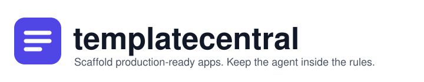
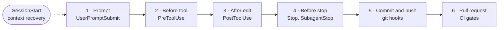

<div align="center">

<picture>
  <source media="(prefers-color-scheme: dark)" srcset="docs/assets/banner-dark.svg">
  
</picture>

**One prompt. Four stacks. Production-ready every time.**

[](https://github.com/cljiahao/templatecentral/releases)
[](https://github.com/cljiahao/templatecentral/actions/workflows/validate-skills.yml)
[](LICENSE)
[](https://github.com/cljiahao/templatecentral)
[](https://github.com/cljiahao/templatecentral/stargazers)

[Quickstart](#quickstart) · [Stacks](#four-stacks) · [Harness](#every-change-clears-six-checkpoints) · [Skills](#skills) · [Other tools](docs/CROSS-TOOL.md) · [Changelog](CHANGELOG.md)

</div>

<!-- DEMO: Replace this comment block with a GIF once you have a recording.
     Recommended: ~30s clip of Claude responding to "Scaffold a Next.js project at ~/projects/my-app"
     from blank terminal to working app.
      -->

## What it is

templatecentral is a Claude Code plugin. Give it one prompt and it generates a working Next.js, Vite + React, FastAPI or NestJS project: install, lint, typecheck, tests, Docker and CI, all wired.

It also seeds a **guard harness** into the project: hooks, git hooks and CI gates that keep the AI agent inside your rules for the life of the project. The guards are plain files in your repo, so they keep running after you uninstall the plugin.

## Quickstart

```bash
claude plugin marketplace add cljiahao/templatecentral
claude plugin install templatecentral
```

Then ask Claude:

```
Scaffold a new Next.js project at ~/projects/my-app
```

Claude generates every file, installs dependencies, runs the verification gates and writes `AGENTS.md`. No stack in mind? Say *"scaffold me a new app"*. Claude asks a couple of use-case questions and recommends one of the four.

Update later with `claude plugin update templatecentral`.

> **Already have a project?** Ask Claude to run `templatecentral:migrate`. It adopts the harness, reuses pipelines that already run a check, and keeps your own rules in `.claude/hooks/local/`. A human then reviews and re-blesses the harness hashes; agents never regenerate them.

## Four stacks

| | **Next.js** | **Vite + React** | **FastAPI** | **NestJS** |
|:--|:--|:--|:--|:--|
| Use for | Product UI, SSR, full-stack web | Client-only SPA, dashboards | Python REST / async API | Enterprise TypeScript API |
| Core | App Router, TypeScript | React 19, React Router, TypeScript | FastAPI, Uvicorn, Pydantic v2 | NestJS on Fastify, TypeScript |
| UI / API | shadcn/ui, Tailwind CSS v4 | shadcn/ui, Tailwind CSS v4 | structlog JSON logging | Swagger, nestjs-pino, nestjs-zod |
| Data / forms | TanStack Query, React Hook Form + Zod | TanStack Query, React Hook Form + Zod | Pydantic models | Zod validation |
| Quality | Prettier, ESLint, lefthook, Vitest | Prettier, ESLint, lefthook, Vitest + Testing Library | Ruff, Pyright, pytest + httpx | Prettier, ESLint, lefthook, Vitest + e2e |
| Ships as | Docker | Docker (Nginx) | Docker | Docker |

Every stack also gets the harness, an integrity manifest (`.claude/harness.json`), shared CI gates for GitHub Actions and Azure Pipelines, and `AGENTS.md` + `CLAUDE.md` + `docs/CONSTITUTION.md`. Add more later with `templatecentral:add`:

`auth` · `database` · `page` · `feature` · `endpoint` · `form` · `integration` · `test` · `logging` · `error-handling` · `pagination` · `mutation-testing` · `ai-security` · `documentation` · `redaction`

## Why a harness

A `CLAUDE.md` asks the agent to follow rules; nothing makes it comply. Under pressure an agent runs `git commit --no-verify`, sets `HUSKY=0`, or edits the hook that blocked it. After a long session compacts, it forgets the project's invariants. Starter templates ship authentication but no authorization, no dependency audit, and secrets one `Write` away. templatecentral replaces the written rules with enforced ones.

## Every change clears six checkpoints



| # | Checkpoint | What it does |
|:-:|:---|:---|
| 1 | **Prompt** (`UserPromptSubmit`) | Blocks prompt-injection phrases and pasted credentials before the model sees them |
| 2 | **Before each tool** (`PreToolUse`) | Secrets hard-blocked · CI and governance edits ask a human · git hook bypasses blocked |
| 3 | **After each edit** (`PostToolUse`) | Type-check and comment-hygiene feedback straight back to the agent |
| 4 | **Before the agent stops** (`Stop`, `SubagentStop`) | Tests must pass before a turn ends; types must pass before a subagent returns |
| 5 | **Commit and push** (git hooks) | Commit-message format and pre-commit checks; pre-push re-checks the harness hashes |
| 6 | **Pull request** (CI gates) | Secret scan, dependency audit, harness integrity; no label bypass |

**Context recovery** (`SessionStart`) re-injects `docs/CONSTITUTION.md` and the universal invariants on start, resume, clear and compact, so the rules survive long sessions. Checkpoints 5 and 6 run in git and CI, so they still hold when someone works without the agent.

The details, such as how the branch guard reads the right folder in a worktree, how every bypass spelling is closed and how upgrades keep your local rules, are in [docs/HARNESS.md](docs/HARNESS.md).

## Proof, not promises

Counts are from running each suite on the 7.2.1 tree. The [CHANGELOG](CHANGELOG.md) records the defects they caught.

| Evidence | Result |
|:---|:---|
| Harness kit regression suite (`scripts/test-harness-kit.sh`) | 772 tests pass |
| OpenCode adapter hook matrix | 157 tests pass |
| Repo guard tests (`scripts/pre-guard.test.sh`) | 131 tests pass |
| Copy script and template trees (`scripts/test-template-copy.sh`) | 1153 tests pass |
| End-to-end sweeps | A real project per stack, built from the skill files: install, format, lint, typecheck, tests with coverage, harness and hook checks all pass |
| Real databases | PostgreSQL 18.3 and MongoDB 8.2 caught that 20 concurrent duplicate sign-ups all succeeded on a fresh Mongo database; now 1 of 20 is stored |

Running the scaffolds, not reading them, has surfaced more than 20 defects, such as anonymous access to `GET /users`, a database connection without TLS and a password hash blocking the event loop. Each is fixed in the skills.

## Skills

Four user-invocable skills:

| Skill | What it does |
|:---|:---|
| `templatecentral:scaffold` | New Next.js, Vite + React, FastAPI or NestJS project from scratch |
| `templatecentral:add` | Add a capability (auth, database, tests, pages, endpoints, forms, logging, …) to an existing project |
| `templatecentral:standards` | Review code quality, naming, validation patterns, drift and full-stack type contracts |
| `templatecentral:migrate` | Adopt the harness in a project built without templatecentral, upgrade to current conventions, switch the DB access layer, or extract a Next.js backend into NestJS / FastAPI |

Four agent utilities, loaded internally and not invoked directly: `build`, `test`, `review`, `cleanup`.

## Works with

[superpowers](https://github.com/obra/superpowers) is strongly recommended for complex multi-file features (brainstorm → plan → execute). Simple one- or two-file tasks go straight to a templatecentral skill.

```bash
claude plugin marketplace add obra/superpowers
```

Optional: [caveman](https://github.com/JuliusBrussee/caveman) cuts output tokens during exploration and Q&A (`claude plugin marketplace add JuliusBrussee/caveman`).

## More

<details>
<summary><b>Compared with an ordinary harness</b></summary>

<br>

| Area | Ordinary harness | templatecentral |
|:---|:---|:---|
| Rules | `CLAUDE.md` the agent may ignore | Hooks that block, plus a constitution re-injected after compaction |
| Hook bypass | Usually only `--no-verify` | All known bypass spellings, judged by the folder the command runs in |
| Hook tampering | Agent can edit the hook | Edits ask a human; hash drift fails push and CI |
| Secrets | `.gitignore` | Writes hard-blocked; reads denied in `permissions.deny` |
| Done check | The agent's word | Tests on `Stop`, types on `SubagentStop` |
| Dependency audit | Optional, skippable by label | Blocking, every ecosystem, expiring allowlist only |
| Authorization | Left to each developer | Deny-by-default helpers with tests, 404 on ownership |
| Upgrades | Copy and paste, local edits lost | Three-way re-sync; local guards kept |
| CI host | One host per setup | GitHub Actions and Azure Pipelines from one script |

</details>

<details>
<summary><b>Other agent tools (OpenCode, Codex, Antigravity)</b></summary>

<br>

Claude Code is the primary target. The skills follow the open [Agent Skills](https://agentskills.io) and [`AGENTS.md`](https://agents.md) standards, so they also run in other compliant tools. Only the Claude-Code-only in-agent hooks differ, and those stay enforced at commit and CI time.

Other tools need each skill's `name` to match its folder, so generate a copy without the `templatecentral:` namespace:

```bash
git clone https://github.com/cljiahao/templatecentral.git
cd templatecentral
bash scripts/build-agents-dist.sh        # → dist/agents-skills/
```

Then point the tool at `dist/agents-skills`. For OpenCode, add to `opencode.json`:

```json
{
  "$schema": "https://opencode.ai/config.json",
  "skills": { "paths": ["/abs/path/to/templatecentral/dist/agents-skills"] }
}
```

For Codex or Antigravity, copy the skills into their scan path:

```bash
cp -R dist/agents-skills/* ~/.agents/skills/     # Codex   (or a project ./.agents/skills/)
cp -R dist/agents-skills/* .agents/skills/       # Antigravity (project-local)
```

Restart the tool afterwards. The optional OpenCode guard plugin, OpenChamber / Docker setup and the guard-parity table are in [docs/CROSS-TOOL.md](docs/CROSS-TOOL.md).

</details>

<details>
<summary><b>Repository structure, scheduled loops, adding a skill</b></summary>

<br>

The annotated tree, the two scheduled workflows (`scaffold-verify`, `ecosystem-refresh`) and the steps for adding a skill are in [docs/REPOSITORY.md](docs/REPOSITORY.md). In short: read `skills/CONVENTIONS.md`, use `/tc-write-skill`, then run `bash scripts/lint-skills.sh skills/` and `bash scripts/validate-manifest.sh` before opening a PR. See [CONTRIBUTING.md](CONTRIBUTING.md) for the full guide.

</details>

## Contributing and license

Contributions are welcome, especially new stacks and coverage gaps. Read [CONTRIBUTING.md](CONTRIBUTING.md) and [SECURITY.md](SECURITY.md). Released under the [MIT License](LICENSE). If templatecentral saves you setup time, a star helps others find it.

[](https://star-history.com/#cljiahao/templatecentral&Date)
